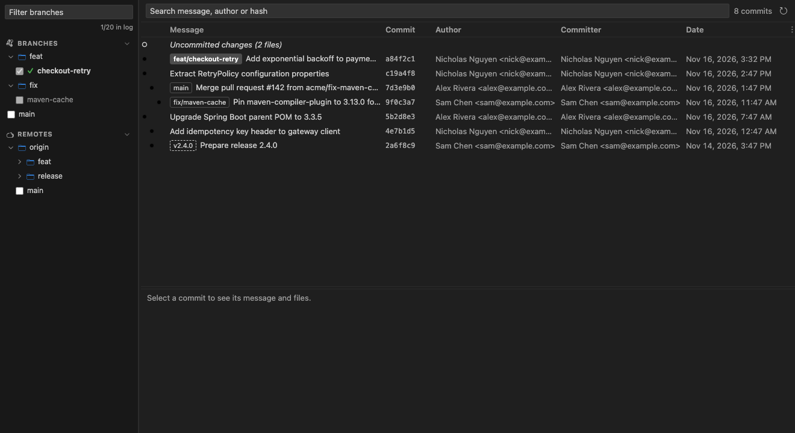
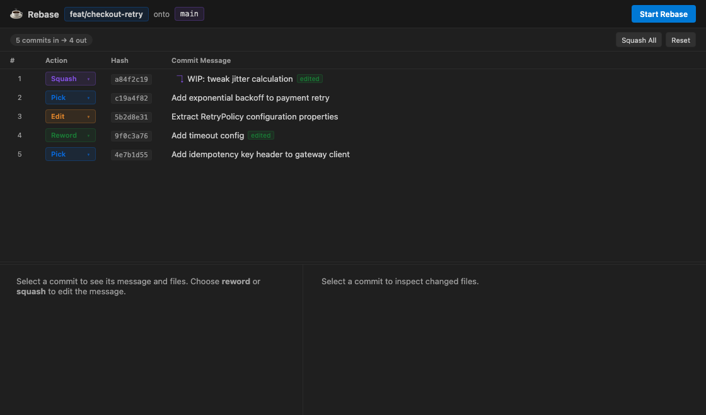
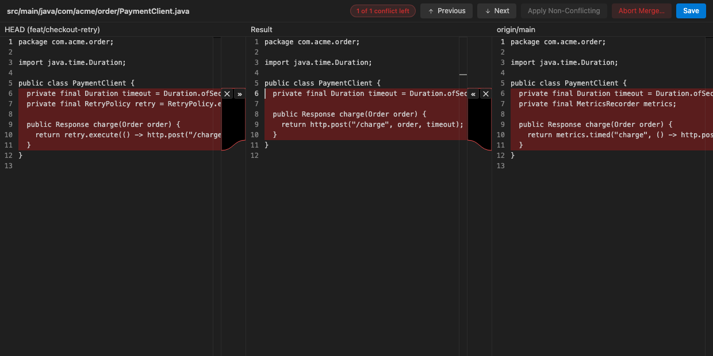

# Branch and Brew

[](https://marketplace.visualstudio.com/items?itemName=nqnhut92.branch-and-brew)
[](LICENSE)

A VS Code extension for developers who work across many Git repositories, with a Java/Maven toolchain built in.

- **Repositories view**: many repositories in groups, with live status, bulk pull and per-group Git identity.
- **Commit log**: a table with a thin graph, branch filter, search and file diffs, in the TortoiseGit style.
- **Three-pane merge**: mine, an editable result and theirs, in the IntelliJ style.
- **Interactive rebase**: a table that stays editable while the rebase runs.
- **Java and Maven**: picks the JDK from `pom.xml`, downloads JDKs and Maven on request, and runs Maven from the context menu.
- **Accounts**: GitHub, Azure DevOps or any HTTPS host, to browse and clone repositories.

## Preview

### Commit Log


### Interactive Rebase


### Three-Pane Merge


## Requirements

- VS Code 1.90 or newer
- Git on `PATH`

## Install

Search for **Branch and Brew** in the Extensions view, install from the [VS Code Marketplace](https://marketplace.visualstudio.com/items?itemName=nqnhut92.branch-and-brew), or run:

```sh
code --install-extension nqnhut92.branch-and-brew
```

To build it yourself: `npm ci && npm run vsix`, then **Extensions: Install from VSIX...**.

## Documentation

- [Features and usage](docs/features.md)
- [Architecture](docs/architecture.md)
- [Development, testing and CI](docs/development.md)
- [Design decisions](docs/DECISIONS.md)
- [Changelog](CHANGELOG.md)

## Licence

MIT
